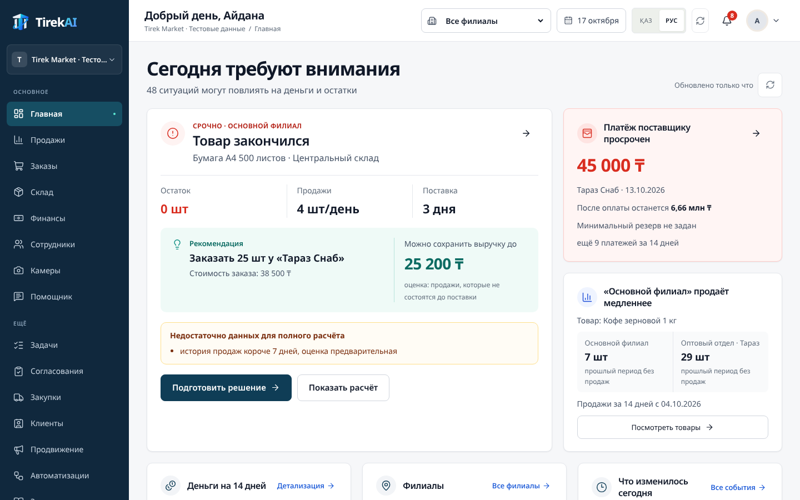
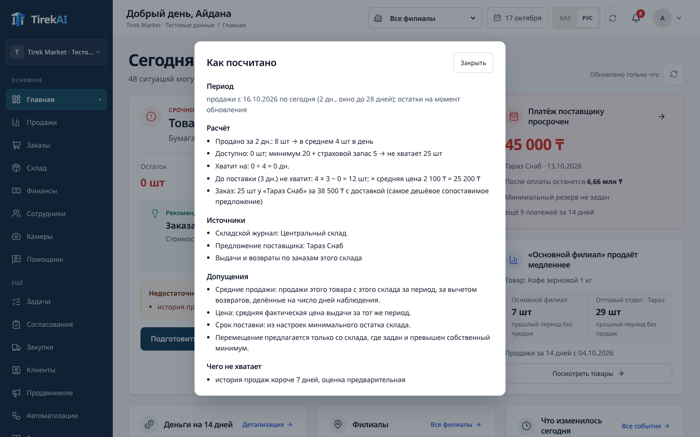
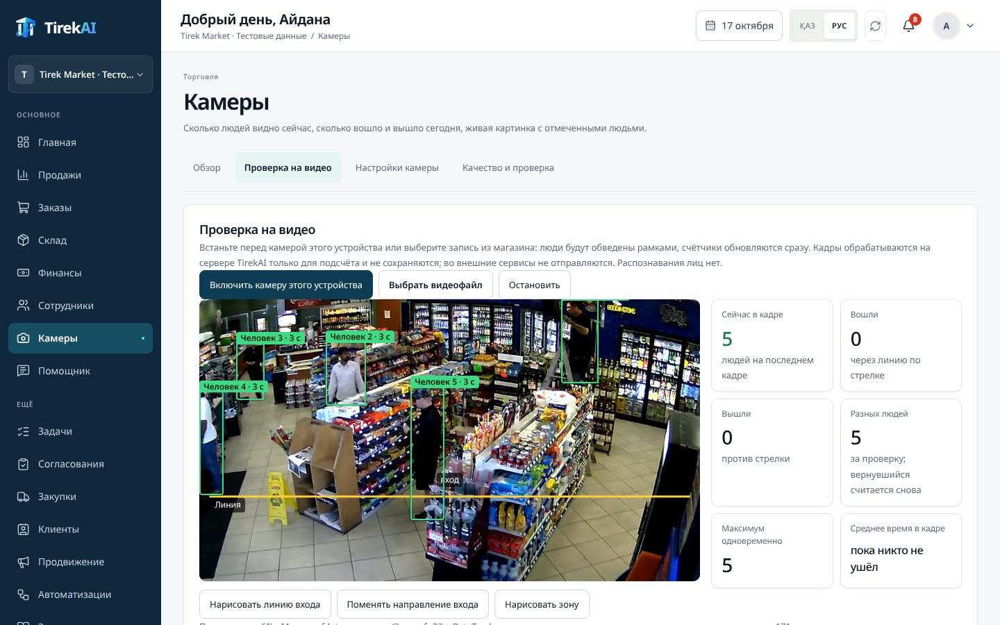
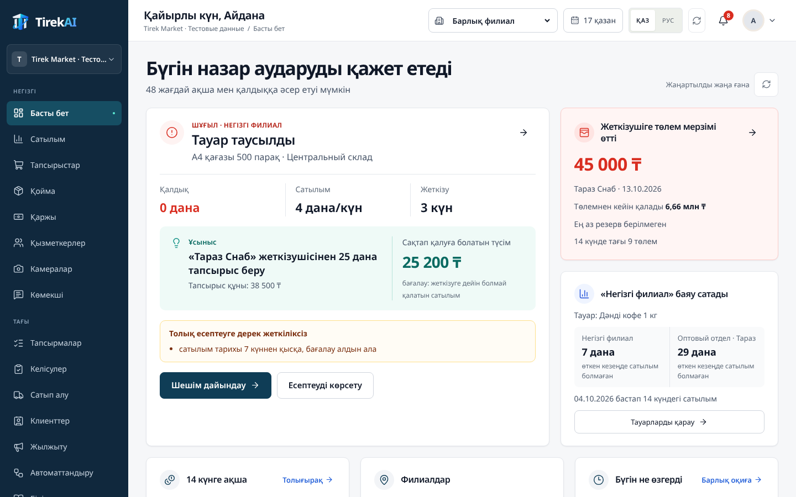
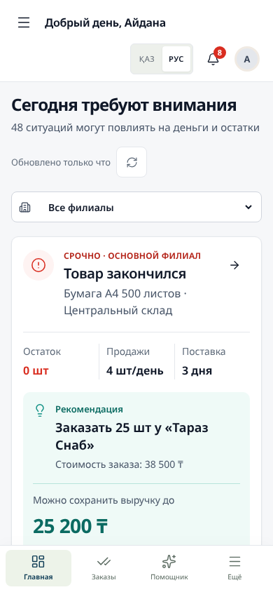
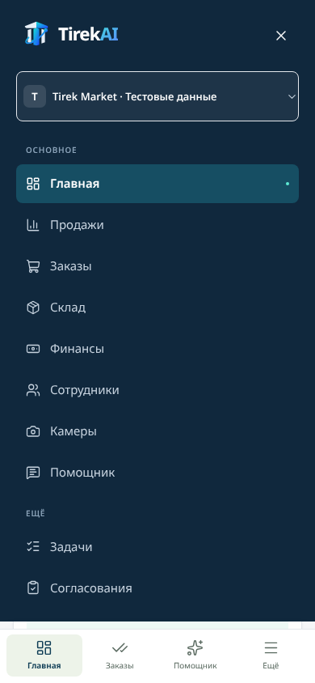
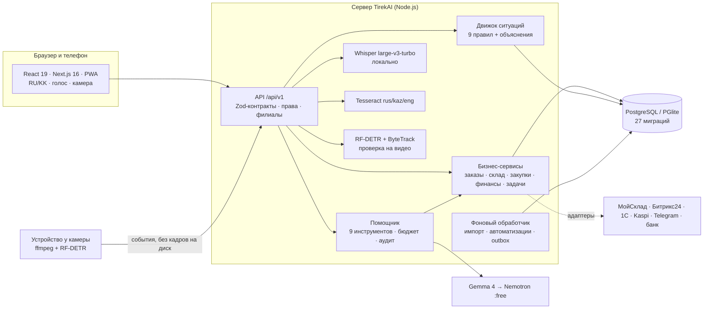

<div align="center">


# TirekAI

**AI-платформа управления малым и средним бизнесом**

🌐 **Онлайн-демо: [tirekai.vercel.app](https://tirekai.vercel.app)**

</div>

**TirekAI — AI-платформа управления малым и средним бизнесом.** Она объединяет продажи, склад, закупки, финансы, сотрудников, документы и камеры, сама находит ситуации, в которых бизнес может потерять деньги или товар, объясняет расчёт и готовит решение для подтверждения человеком.

Помощник — только один из способов работать с платформой. TirekAI также распознаёт накладные, считает посетителей и очереди по камерам, следит за остатками и платежами, сравнивает варианты закупки и перемещения товара, создаёт задачи и сопровождает решение до фактического исполнения.

<div align="center">

| **17** | **8** | **329** | **RU / KK** | **3 команды** |
| :---: | :---: | :---: | :---: | :---: |
| разделов платформы | отраслевых профилей | автотестов проходят | полноценные языки интерфейса | от клона до работающего демо |

[Проверка за 3 минуты](#-проверка-за-3-минуты) · [Чем это не CRM](#-не-чат-бот-и-не-crm) · [AI внутри](#-ai-и-it-технологии) · [Критерии жюри](#-как-проект-отвечает-критериям-хакатона) · [Запуск](#-запуск-за-3-команды) · [Архитектура](#-архитектура)



<sub>Главный экран «Сегодня требуют внимания» — живое приложение на демо-бизнесе «Tirek Market», не макет.</sub>

</div>

---

## 🔁 Не чат-бот и не CRM

**Обычная CRM хранит записи. TirekAI связывает данные и показывает, какое решение сейчас требует внимания.**

| | Чат-бот | CRM / учётная система | **TirekAI** |
| --- | --- | --- | --- |
| Где данные | Нет своих данных | Хранит заказы и клиентов | **Продажи, склад, закупки, финансы, задачи, документы и камеры — в одной модели** |
| Кто находит проблему | Пользователь должен спросить | Пользователь должен построить отчёт | **Система сама: 9 правил ежедневно ищут потери денег и товара** |
| Объяснение | «Поверьте модели» | Таблица без выводов | **Формула, период, источники и чего не хватает для точной оценки** |
| Действие | Совет текстом | Ручной ввод документа | **Готовый черновик решения → согласование → исполнение → проверка результата** |
| Контроль | Модель может «додумать» | Права на записи | **AI предлагает, деньги и склад меняет только человек; права по ролям и филиалам, аудит** |

```text
Данные → Ситуация → Объяснение → Готовое решение → Согласование человеком → Исполнение → Проверка результата
```

Пример с главного экрана (расчёт на 17.10.2026; цифры пересчитываются каждый день по фактическим продажам):

> **Товар закончился · Бумага A4 · Центральный склад.** Остаток 0 шт, продают 4 шт/день, поставка 3 дня.
> **Рекомендация:** заказать 25 шт у «Тараз Снаб» за 38 500 ₸ — *можно сохранить выручку до 25 200 ₸*.

<table>
<tr>
<td width="50%"><br/><sub><b>«Как посчитано».</b> Каждая сумма раскрывается: период, формула, источники, допущения. Если данных мало — система прямо пишет, чего не хватает, а не подставляет ноль.</sub></td>
<td width="50%"><br/><sub><b>Камеры в магазине.</b> RF-DETR + ByteTrack: посетители обведены рамками, счётчики «сейчас в кадре», «вошли через линию», «разных людей», время в кадре — в реальном времени. Без распознавания лиц. Видео: демо-ролик камеры ACTi в магазине (YouTube).</sub></td>
</tr>
</table>

## ⏱ Проверка за 3 минуты

**Локальный запуск (один раз, ~2 минуты):**

```bash
npm ci
npm run db:seed:business && npm run demo:prepare && npm run demo:today
npm run build && npm run preview          # http://127.0.0.1:3000
```

**Онлайн:** [tirekai.vercel.app](https://tirekai.vercel.app) — данные для входа в демо-аккаунт выдаёт команда.

**Локально — вход.** Демо-аккаунт синтетического бизнеса «Tirek Market» (3 филиала, 72 заказа, 12 закупок, 24 задачи) создаётся командой выше. Логин и пароль записываются в `.local/tirekai-business.json` — пароль генерируется случайно при создании, поэтому не публикуется в репозитории. Можно и просто зарегистрировать свой аккаунт на странице входа.

| Шаг | Что сделать | Что увидеть |
| --- | --- | --- |
| **1. Вход** | Войти, открыть **Главная** | «Сегодня требуют внимания» и число ситуаций, которые могут повлиять на деньги и остатки |
| **2. Проблема** | Посмотреть главную карточку и правую колонку | «Товар закончился»: остаток, продажи в день, срок поставки; просроченный платёж поставщику и остаток денег после него |
| **3. Расчёт** | Нажать **«Показать расчёт»** | Период продаж, формула `продажи в день × дни поставки − остаток = недостача × средняя цена`, источники, допущения и чего не хватает |
| **4. Изменение условия** | В «Деньги на 14 дней» → **«Задать резерв»** → сумма больше текущего остатка (например, `7000000`) → «Сохранить». Затем выбрать другой филиал в верхней панели | Карточка платежа сразу показывает **«Ниже минимального резерва»**, на графике появляется линия минимума; при смене филиала все блоки пересчитываются для него |
| **5. Решение** | Нажать **«Подготовить решение»** → «Открыть согласования» → «Показать: Черновики» | Черновик закупки с поставщиком, количеством и бюджетом. Его отправляют на согласование; согласует второй человек (вход согласующего — `.local/tirekai-demo.json`), после этого — исполнение и проверка результата |

Дополнительно за минуту: **Камеры → Проверка на видео → «Включить камеру этого устройства»** (люди считаются в кадре) и вопрос голосом в строке **«Спросите TirekAI…»**.

## 🧠 AI и IT-технологии

| Компонент | Технология | Что делает в продукте | Результаты замеров |
| --- | --- | --- | --- |
| **Помощник** | Gemma 4 26B (Gemini API) → резерв Nemotron 3.5 Super VL `:free` (OpenRouter), **только бесплатные маршруты** | Отвечает на вопросы о бизнесе через **9 инструментов** с правами пользователя: остатки, ситуации, финансы, задачи, бюджет закупки, база знаний, черновик закупки. Показывает, какие инструменты вызвал и на какие источники опирается. | Суммы в ответах сверяются с расчётным слоем; бюджет токенов и предел входа контролируются до каждого вызова |
| **Голос** | OpenAI **Whisper large-v3-turbo**, ONNX, **локально на CPU** | Вопрос голосом на казахском или русском: распознаётся на сервере TirekAI (аудио не уходит во внешние сервисы) и отправляется сам. Неуверенные слова, суммы и отрицания помечаются для проверки. | Записи живых дикторов (FLEURS): **WER kk 24,1 %, ru 3,4 %**, ≈ реальное время на 4 vCPU |
| **Компьютерное зрение** | **RF-DETR Nano** (Apache-2.0) + собственная реализация **ByteTrack** + фильтр Калмана | Камера магазина или видеофайл: люди обведены рамками, счётчики «сейчас в кадре», «вошли/вышли через линию», «разных людей», время в зоне, очереди. Распознавания лиц нет, кадры не сохраняются. | Запись реального магазина: **посетители в кадре найдены и отслежены**, уверенность 0,77–0,89, 145 мс/кадр на обычном CPU · открытые записи Intel: **7/7 и 6/6 людей**, пустой кадр — 0 |
| **OCR накладных** | Tesseract.js, языки **rus / kaz / eng**, локально | Фото или PDF накладной → строки, количества, цены → подсказки в форме проверки; расхождения с заказом подсвечиваются. Склад меняется только после фактической приёмки. | Демо-накладная распознаётся за 3,6–4,2 с |
| **Движок ситуаций** | 9 правил с объяснимыми фактами | Нехватка товара, просроченные долги клиентов и поставщикам, продажа ниже себестоимости, неизвестная себестоимость, нет цены продажи, просроченные задачи, закупки без решения, документы на проверке. | Каждая ситуация хранит формулу, факты и источники |
| **AI в автоматизациях** | LLM → черновик правила | Правило «событие → условие → действие» описывается словами; AI предлагает только черновик, который человек проверяет и тестирует. | Правило включается только после успешного пробного прогона |

**Принцип безопасности AI.** Модель не имеет инструмента для платежа или произвольного SQL. Любое действие с деньгами или складом проходит через бизнес-сервисы с проверкой прав, области филиала, идемпотентностью, версией документа и аудитом. AI предлагает — человек согласует.

<table>
<tr>
<td width="50%"><br/><sub><b>Камеры в магазине.</b> RF-DETR + ByteTrack: посетители обведены рамками, счётчики «сейчас в кадре», «вошли через линию», «разных людей», время в кадре — в реальном времени. Без распознавания лиц. Видео: демо-ролик камеры ACTi в магазине (YouTube).</sub></td>
<td width="50%"><br/><sub><b>«Показать расчёт».</b> Период, формула, источники, допущения и честный список того, чего не хватает для точной оценки.</sub></td>
</tr>
</table>

## 🏆 Как проект отвечает критериям хакатона

| Критерий | Что сделано в TirekAI |
| --- | --- |
| **1. Соответствие и глубина решения кейса** | Не чат-бот поверх таблицы, а рабочая система МСБ: клиенты, заказы, склад, закупки, финансы, задачи, согласования, база знаний, камеры, помощник. **17 разделов**, **8 отраслевых профилей** (торговля, общепит и пекарня, услуги, учебный центр, проектная компания, производство, строительство, клиника). Заказ, исполнение, оплата и возврат — разные события, как в реальном учёте; склад меняет только фактическая приёмка. |
| **2. Использование AI/IT-технологий** | Шесть AI/ML-компонентов, все в рабочих сценариях: LLM-помощник с инструментами (Gemma 4 / Nemotron, бесплатные маршруты), локальное распознавание речи **Whisper large-v3-turbo** (RU/KK), **детектор людей RF-DETR + трекер ByteTrack** для камер магазина, **OCR накладных** (Tesseract rus/kaz/eng), движок ситуаций с объяснимыми расчётами, AI-черновики правил автоматизации. |
| **3. Креативность и инновационность** | **Объяснимость вместо «чёрного ящика»**: у каждой суммы есть формула, период и источник. **Честность данных**: если чего-то нет, система пишет «чего не хватает», а не подставляет ноль. **Казахский язык первым**, включая голос. **Камеры без распознавания лиц**: только рамки и счётчики, кадры не сохраняются. **Прогноз против факта**: решение сравнивается с фактическим результатом. |
| **4. Реализация MVP** | Работает end-to-end на демо-бизнесе «Tirek Market» (3 филиала, 72 заказа, 12 закупок, 24 задачи). **~60 000 строк TypeScript**, **27 миграций БД**, **282 модульных + 18 PostgreSQL + 29 браузерных тестов** проходят. Скриншоты в этом README — живое приложение, а не макеты. |
| **5. Качество презентации** | [Проверка за 3 минуты](#-проверка-за-3-минуты), сценарий показа на 5 минут ([ниже](#-демо-за-5-минут), подробно — [docs/DEMO_SCENARIOS.md](docs/DEMO_SCENARIOS.md)), команды подготовки и сброса демо, автоматическая репетиция `npm run demo:rehearse`. Интерфейс по утверждённому дизайну, проверен на 1440, 1280, 1024 и 390 px. |

## 🧩 Что умеет платформа

- **Главная «Сегодня требуют внимания»:**
  - главная ситуация с расчётом и готовым решением;
  - платёж поставщику и остаток денег после него;
  - медленный филиал;
  - прогноз денег на 14 дней с минимальным резервом;
  - выручка филиалов к тому же времени вчера;
  - события дня;
  - вопрос помощнику текстом или голосом.
- **Продажи и заказы:**
  - резерв товара при подтверждении;
  - частичное исполнение и частичная оплата;
  - возврат из конкретной выдачи;
  - каналы продаж с комиссией и выплатой;
  - сравнение прогноза с фактом.
- **Склад:**
  - единицы и упаковки;
  - приёмка, резервы, выдача, возврат;
  - перемещение между складами с товаром в пути;
  - инвентаризация, минимальные остатки.
- **Закупки:**
  - сравнение предложений поставщиков по полной стоимости, включая доставку;
  - бюджет, согласование;
  - OCR накладной, расхождения, фактическая приёмка.
- **Финансы:**
  - счета, журнал, обязательства;
  - платёжный календарь со сценариями;
  - выписка банка в формате 1CClientBankExchange со сверкой.
- **Команда:**
  - роли (собственник, управляющий, продажи, закупки, финансы, сотрудник, наблюдатель);
  - доступ по филиалам, приглашения;
  - задачи с подтверждением исполнения;
  - согласования с лимитами и делегированием.
- **Знания и автоматизации:**
  - инструкции с версиями;
  - правила «событие → условие → действие» с тестовым прогоном и журналом.
- **Продвижение:**
  - акции с проверкой маржи по фактической себестоимости;
  - материалы на двух языках, экспорт в PDF.
- **Интеграции:** МойСклад, Битрикс24, 1С (OData), Kaspi, Telegram, банковская выписка.
  - Это адаптеры с контрактными тестами; живые подключения — по ключам заказчика.
- **PWA:** установка на телефон, экран без сети на RU/KK.

<table>
<tr>
<td width="62%"><br/><sub><b>Қазақша.</b> Казахский — полноценный язык интерфейса, а не перевод «для галочки».</sub></td>
<td width="19%"><br/><sub><b>Телефон.</b> Главное решение — первым.</sub></td>
<td width="19%"><br/><sub><b>Меню</b> на весь экран.</sub></td>
</tr>
</table>

## 🎬 Демо за 5 минут

| Шаг | Что показать | Что сказать жюри |
| --- | --- | --- |
| 1 · 0:00 | **Главная** — «Товар закончился», платёж поставщику, деньги на 14 дней | «Система сама нашла, где бизнес теряет деньги сегодня» |
| 2 · 0:40 | **Показать расчёт** | «Каждая цифра объяснима: формула, период, источники. Если данных мало — так и написано» |
| 3 · 1:20 | **Подготовить решение** → **Согласования** → второй человек согласует → исполнение | «AI готовит решение, но деньги тратит только человек» |
| 4 · 2:20 | **Закупки** → загрузить накладную → OCR → расхождение цены → фактическая приёмка | «Фото накладной превращается в проверенный приход на склад» |
| 5 · 3:20 | **Камеры → Проверка на видео** → веб-камера или запись магазина | «Люди считаются в реальном времени, без распознавания лиц» |
| 6 · 4:10 | Вопрос голосом на казахском в строке «Спросите TirekAI…» | «Голос распознаётся локально, ответ — по данным бизнеса с источниками» |
| 7 · 4:40 | Переключить **ҚАЗ/РУС**, открыть на телефоне | «Казахский — полноценный язык интерфейса, всё работает с телефона» |

Подготовка и сброс демо-данных: [docs/DEMO_SCENARIOS.md](docs/DEMO_SCENARIOS.md).

## 🚀 Запуск за 3 команды

Нужны Node.js 22.20+ и npm. Docker не нужен: база PostgreSQL работает внутри приложения (PGlite) в папке `.data/`.

```bash
npm ci
npm run db:seed:business   # синтетический бизнес «Tirek Market»: 3 филиала, 72 заказа, 12 закупок
npm run dev                # http://127.0.0.1:3000
```

Логин и случайный пароль демо-аккаунта появятся в `.local/tirekai-business.json`; этот файл не попадает в Git.

Для показа:

```bash
npm run demo:prepare   # данные сценариев показа и точка сброса (сервер остановлен)
npm run demo:today     # продажи «сегодня» для главного экрана
npm run build
npm run preview        # production-сборка на http://127.0.0.1:3000
```

Подключение AI-компонентов (все необязательны, без них приложение работает и честно пишет «не подключено»):

| Что | Как включить |
| --- | --- |
| Помощник (бесплатные модели) | `.env.local`: `ASSISTANT_PROVIDER=free`, `GEMINI_API_KEY`, `OPENROUTER_API_KEY` → [docs/AI_PROVIDERS.md](docs/AI_PROVIDERS.md) |
| Голос RU/KK | `npm run speech:model` (≈ 1,3 ГБ, один раз), `SPEECH_PROVIDER=local` → [docs/LOCAL_MODELS.md](docs/LOCAL_MODELS.md) |
| Люди на видео | `npm run video:model`; камера Windows — [docs/CAMERA_WINDOWS.md](docs/CAMERA_WINDOWS.md) |

Ручные сценарии проверки и эксплуатация: [docs/GUIDE.md](docs/GUIDE.md), [docs/RUNBOOK.md](docs/RUNBOOK.md).

## 🏗 Архитектура



**Инженерные правила, которые держит код:**
- **Деньги** хранятся строками в тиынах (bigint), JS `Number` для сумм не используется.
- **Количества** — Decimal до 6 знаков.
- **Отсутствующая цена, себестоимость или курс** не превращаются в ноль.
- **Каждая бизнес-команда** проходит:
  - проверку входа и ответа (Zod);
  - серверную авторизацию с областью организации и филиала;
  - ключ идемпотентности;
  - версию документа против потерянных правок;
  - запись аудита в той же транзакции.
- **Заказ, исполнение, деньги и возврат** — отдельные события; склад меняет только фактическая приёмка.
- **Секреты, `.data/`, `.local/`, `.env*`** не попадают в Git; проверка `npm run check:secrets`.

## ✅ Качество и проверки

| Проверка | Результат (17.10.2026) |
| --- | --- |
| `npm run lint` · `typecheck` · prettier | без ошибок |
| `npm test` — модульные и интеграционные (Vitest) | **282 / 282** |
| `npm run test:postgres` — изолированный PostgreSQL 16 | **18 / 18** |
| `npm run test:e2e` — браузерные сценарии (Playwright) | **29 сценариев**: заказы, склад, закупки, согласования, главная, голос, камеры, 8 отраслей, RU/KK, телефон 360–430 px, клавиатура, текст 200 %, axe WCAG 2.1 AA |
| `npm audit` · `check:secrets` | 0 уязвимостей · 0 находок |

Подробные протоколы с фактическими цифрами: [docs/TESTING.md](docs/TESTING.md).

## 🛣 Следующий шаг — пилот

Платформа готова к пилоту в действующем бизнесе. Что делаем на пилоте:

- **Данные предприятия.** Демо «Tirek Market» создано через те же бизнес-сервисы, что и для реальной работы; на пилоте — импорт клиентов, товаров и остатков предприятия (CSV/TSV уже поддерживается) и подключение его учётной системы.
- **Интеграции.** Адаптеры МойСклад, Битрикс24, 1С, Kaspi, Telegram и банковской выписки готовы и покрыты контрактными тестами; на пилоте подключаются ключи заказчика.
- **Камеры.** Линии и зоны настраиваются под конкретный магазин прямо в приложении; на пилоте точность подсчёта сверяется с ручным счётом на камерах предприятия.
- **Голос и помощник.** Работают на бесплатных моделях и локальном распознавании; на пилоте — словарь товаров и терминов предприятия.

Статус каждой задачи — [docs/TASKS.md](docs/TASKS.md), протоколы проверок — [docs/TESTING.md](docs/TESTING.md).

## 📚 Документация

| Документ | Для чего |
| --- | --- |
| [SPECIFICATION.md](SPECIFICATION.md) · [DEVELOPMENT_PLAN.md](DEVELOPMENT_PLAN.md) | Исходное ТЗ и план |
| [docs/DEMO_SCENARIOS.md](docs/DEMO_SCENARIOS.md) | Сценарии показа, подготовка и сброс |
| [docs/ARCHITECTURE.md](docs/ARCHITECTURE.md) · [docs/DATA_MODEL.md](docs/DATA_MODEL.md) · [docs/API.md](docs/API.md) | Устройство системы |
| [docs/AI_PROVIDERS.md](docs/AI_PROVIDERS.md) · [docs/LOCAL_MODELS.md](docs/LOCAL_MODELS.md) | Выбор моделей, лицензии, замеры |
| [docs/TIREKAI_DESIGN.md](docs/TIREKAI_DESIGN.md) | Дизайн-система и экраны |
| [docs/SECURITY.md](docs/SECURITY.md) · [docs/TESTING.md](docs/TESTING.md) · [docs/RUNBOOK.md](docs/RUNBOOK.md) | Безопасность, проверки, эксплуатация |
| [docs/GUIDE.md](docs/GUIDE.md) | Подробный запуск и ручные сценарии |
| [PROGRESS.md](PROGRESS.md) · [docs/TASKS.md](docs/TASKS.md) | Ход работ и статус задач T001–T058 |

---

<details>
<summary><b>Қазақша қысқаша</b></summary>

**TirekAI** — Қазақстандағы шағын және орта бизнеске арналған AI-тірек. Жүйе бизнестің ақша мен тауарды қай жерде жоғалтып жатқанын өзі табады, есептеуді қарапайым тілмен түсіндіреді, шешім дайындайды және оны адамның келісуіне береді. Басты бет «Бүгін назар аударуды қажет етеді»: тауар таусылуы, жеткізушіге төлем, 14 күндік ақша болжамы, филиалдар, күн оқиғалары. AI құрамдас бөліктері: құралдары бар көмекші (Gemma 4), жергілікті дауысты тану (Whisper, қазақ және орыс тілдері), камерадағы адамдарды санау (RF-DETR + ByteTrack, бет тану жоқ), жүкқұжатты OCR арқылы тану. Интерфейс толықтай қазақ және орыс тілдерінде, компьютер мен телефонда жұмыс істейді.

</details>

<details>
<summary><b>English summary</b></summary>

**TirekAI** is an AI operating layer for small and medium businesses in Kazakhstan. It detects where a business is losing money or stock today (stock-outs, supplier payments vs. cash reserve, slow branches), explains every number with formula, period and sources, prepares a decision (e.g. a purchase draft) and routes it to a human for approval. AI components: a tool-using assistant on free Gemma 4 / Nemotron routes, local Whisper speech recognition for Kazakh and Russian, RF-DETR + ByteTrack people counting for store cameras (no face recognition), Tesseract OCR for supplier invoices, and an explainable situation engine. Kazakh and Russian UI, desktop and mobile, 282 unit + 18 PostgreSQL + 29 end-to-end tests.

</details>

<div align="center"><sub>TirekAI · «тірек» — опора.</sub></div>
